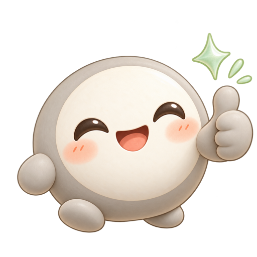
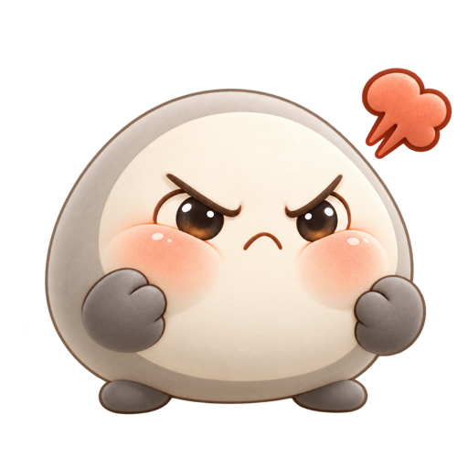
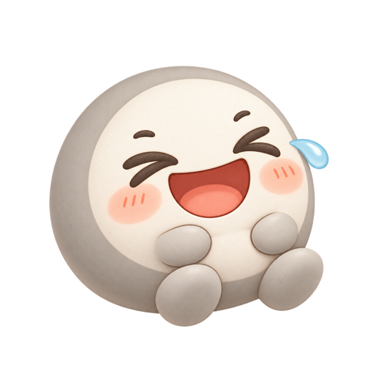
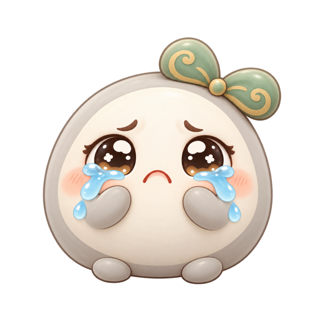
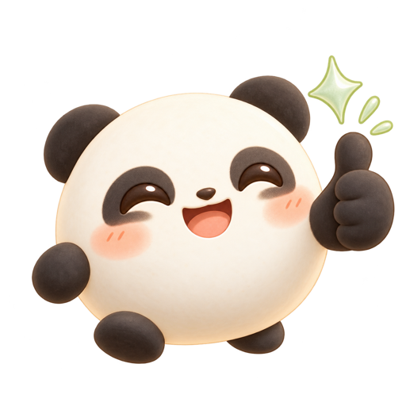
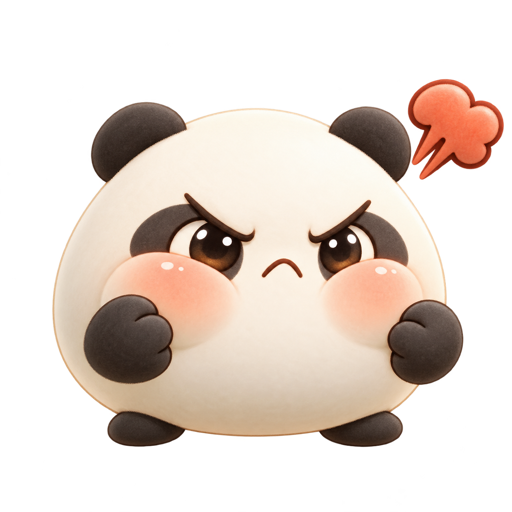
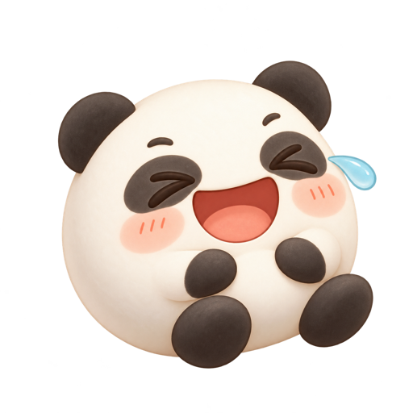
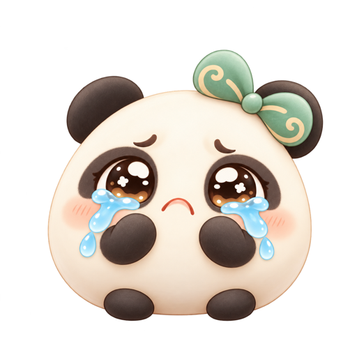

# 黑色相关表情 · 两套概念样图

仅供风格选择，未接入游戏。通过内置 imagegen 工具逐张生成，以现有奶油白表情为动作参考；透明 PNG，预览文件为 512 × 512。

- A 奶灰棋子：浅暖灰外圈和身体，大面积奶油色脸部，保留棋子造型。
- B 奶油熊猫：奶油白主体，深灰耳朵、眼圈和手脚，柔和哑光质感。

| 方案 | 点赞 | 生气 | 大笑 | 哭哭 |
| --- | --- | --- | --- | --- |
| A 奶灰棋子 |  |  |  |  |
| B 奶油熊猫 |  |  |  |  |

## 生成提示词

### milk-gray/like

Use case: stylized-concept. Asset type: one transparent cute emote sticker, part of a four-expression matching set for a warm Gomoku game. Reference image is a pose and emotion guide; create a NEW alternate character, not a dark recolor. Subject: A cute round Go stone mascot, NOT an animal, with a LIGHT warm milk-gray outer body (like warm silver-gray, approximately #B9B4AC), a large ivory cream circular face area occupying about 70 percent of the front, tiny soft charcoal-gray hands and feet, peach blush cheeks. The cream face must dominate, with plenty of light tones and lively dark eyes. No black full-body coloring, no ears, no cap. Strong continuity across all four stickers. Action: a joyful clearly raised thumbs-up, delighted smiling eyes and a tiny celadon sparkle. Style: very cute soft matte clay toy, rounded squishy proportions, gentle diffuse lighting, soft warm shading, clean crisp silhouette, readable at 56 px, no hard reflections, no metallic or glossy finish. Match the reference sticker's general framing and warm friendly rendering. One complete character centered on a square canvas, ample transparent padding on every edge. Genuinely transparent background. No text, logos, watermark, checkerboard pattern, scene or floor. The previous black ceramic set was too dark: this version MUST feel light, sweet and cuddly.

### milk-gray/angry

Use case: stylized-concept. Asset type: one transparent cute emote sticker, part of a four-expression matching set for a warm Gomoku game. Reference image is a pose and emotion guide; create a NEW alternate character, not a dark recolor. Subject: A cute round Go stone mascot, NOT an animal, with a LIGHT warm milk-gray outer body (like warm silver-gray, approximately #B9B4AC), a large ivory cream circular face area occupying about 70 percent of the front, tiny soft charcoal-gray hands and feet, peach blush cheeks. The cream face must dominate, with plenty of light tones and lively dark eyes. No black full-body coloring, no ears, no cap. Strong continuity across all four stickers. Action: adorably annoyed puffed peach cheeks, small clenched fists, furrowed brows, a tiny terracotta steam puff; playful rather than aggressive. Style: very cute soft matte clay toy, rounded squishy proportions, gentle diffuse lighting, soft warm shading, clean crisp silhouette, readable at 56 px, no hard reflections, no metallic or glossy finish. Match the reference sticker's general framing and warm friendly rendering. One complete character centered on a square canvas, ample transparent padding on every edge. Genuinely transparent background. No text, logos, watermark, checkerboard pattern, scene or floor. The previous black ceramic set was too dark: this version MUST feel light, sweet and cuddly.

### milk-gray/laugh

Use case: stylized-concept. Asset type: one transparent cute emote sticker, part of a four-expression matching set for a warm Gomoku game. Reference image is a pose and emotion guide; create a NEW alternate character, not a dark recolor. Subject: A cute round Go stone mascot, NOT an animal, with a LIGHT warm milk-gray outer body (like warm silver-gray, approximately #B9B4AC), a large ivory cream circular face area occupying about 70 percent of the front, tiny soft charcoal-gray hands and feet, peach blush cheeks. The cream face must dominate, with plenty of light tones and lively dark eyes. No black full-body coloring, no ears, no cap. Strong continuity across all four stickers. Action: laughing with eyes squeezed shut and an open smiling mouth, little hands near tummy, one tiny light-blue laughing tear. Style: very cute soft matte clay toy, rounded squishy proportions, gentle diffuse lighting, soft warm shading, clean crisp silhouette, readable at 56 px, no hard reflections, no metallic or glossy finish. Match the reference sticker's general framing and warm friendly rendering. One complete character centered on a square canvas, ample transparent padding on every edge. Genuinely transparent background. No text, logos, watermark, checkerboard pattern, scene or floor. The previous black ceramic set was too dark: this version MUST feel light, sweet and cuddly.

### milk-gray/cry

Use case: stylized-concept. Asset type: one transparent cute emote sticker, part of a four-expression matching set for a warm Gomoku game. Reference image is a pose and emotion guide; create a NEW alternate character, not a dark recolor. Subject: A cute round Go stone mascot, NOT an animal, with a LIGHT warm milk-gray outer body (like warm silver-gray, approximately #B9B4AC), a large ivory cream circular face area occupying about 70 percent of the front, tiny soft charcoal-gray hands and feet, peach blush cheeks. The cream face must dominate, with plenty of light tones and lively dark eyes. No black full-body coloring, no ears, no cap. Strong continuity across all four stickers. Action: big watery puppy eyes, light-blue tears and a tiny sympathetic pout, hands by cheeks; optional tiny celadon bow matching reference. Style: very cute soft matte clay toy, rounded squishy proportions, gentle diffuse lighting, soft warm shading, clean crisp silhouette, readable at 56 px, no hard reflections, no metallic or glossy finish. Match the reference sticker's general framing and warm friendly rendering. One complete character centered on a square canvas, ample transparent padding on every edge. Genuinely transparent background. No text, logos, watermark, checkerboard pattern, scene or floor. The previous black ceramic set was too dark: this version MUST feel light, sweet and cuddly.

### cream-panda/like

Use case: stylized-concept. Asset type: one transparent cute emote sticker, part of a four-expression matching set for a warm Gomoku game. Reference image is a pose and emotion guide; create a NEW alternate character, not a dark recolor. Subject: An adorable round cream-white Go stone mascot reimagined as a baby panda: warm ivory round body and face, two tiny rounded soft-black ears, small charcoal eye patches framing large expressive shiny eyes, tiny charcoal paws and feet, peach blush cheeks. At least 75 percent of visible body area is light cream; black is only small panda details. Strong continuity across all four stickers. Action: a joyful clearly raised thumbs-up, delighted smiling eyes and a tiny celadon sparkle. Style: very cute soft matte clay toy, rounded squishy proportions, gentle diffuse lighting, soft warm shading, clean crisp silhouette, readable at 56 px, no hard reflections, no metallic or glossy finish. Match the reference sticker's general framing and warm friendly rendering. One complete character centered on a square canvas, ample transparent padding on every edge. Genuinely transparent background. No text, logos, watermark, checkerboard pattern, scene or floor. The previous black ceramic set was too dark: this version MUST feel light, sweet and cuddly.

### cream-panda/angry

Use case: stylized-concept. Asset type: one transparent cute emote sticker, part of a four-expression matching set for a warm Gomoku game. Reference image is a pose and emotion guide; create a NEW alternate character, not a dark recolor. Subject: An adorable round cream-white Go stone mascot reimagined as a baby panda: warm ivory round body and face, two tiny rounded soft-black ears, small charcoal eye patches framing large expressive shiny eyes, tiny charcoal paws and feet, peach blush cheeks. At least 75 percent of visible body area is light cream; black is only small panda details. Strong continuity across all four stickers. Action: adorably annoyed puffed peach cheeks, small clenched fists, furrowed brows, a tiny terracotta steam puff; playful rather than aggressive. Style: very cute soft matte clay toy, rounded squishy proportions, gentle diffuse lighting, soft warm shading, clean crisp silhouette, readable at 56 px, no hard reflections, no metallic or glossy finish. Match the reference sticker's general framing and warm friendly rendering. One complete character centered on a square canvas, ample transparent padding on every edge. Genuinely transparent background. No text, logos, watermark, checkerboard pattern, scene or floor. The previous black ceramic set was too dark: this version MUST feel light, sweet and cuddly.

### cream-panda/laugh

Use case: stylized-concept. Asset type: one transparent cute emote sticker, part of a four-expression matching set for a warm Gomoku game. Reference image is a pose and emotion guide; create a NEW alternate character, not a dark recolor. Subject: An adorable round cream-white Go stone mascot reimagined as a baby panda: warm ivory round body and face, two tiny rounded soft-black ears, small charcoal eye patches framing large expressive shiny eyes, tiny charcoal paws and feet, peach blush cheeks. At least 75 percent of visible body area is light cream; black is only small panda details. Strong continuity across all four stickers. Action: laughing with eyes squeezed shut and an open smiling mouth, little hands near tummy, one tiny light-blue laughing tear. Style: very cute soft matte clay toy, rounded squishy proportions, gentle diffuse lighting, soft warm shading, clean crisp silhouette, readable at 56 px, no hard reflections, no metallic or glossy finish. Match the reference sticker's general framing and warm friendly rendering. One complete character centered on a square canvas, ample transparent padding on every edge. Genuinely transparent background. No text, logos, watermark, checkerboard pattern, scene or floor. The previous black ceramic set was too dark: this version MUST feel light, sweet and cuddly.

### cream-panda/cry

Use case: stylized-concept. Asset type: one transparent cute emote sticker, part of a four-expression matching set for a warm Gomoku game. Reference image is a pose and emotion guide; create a NEW alternate character, not a dark recolor. Subject: An adorable round cream-white Go stone mascot reimagined as a baby panda: warm ivory round body and face, two tiny rounded soft-black ears, small charcoal eye patches framing large expressive shiny eyes, tiny charcoal paws and feet, peach blush cheeks. At least 75 percent of visible body area is light cream; black is only small panda details. Strong continuity across all four stickers. Action: big watery puppy eyes, light-blue tears and a tiny sympathetic pout, hands by cheeks; optional tiny celadon bow matching reference. Style: very cute soft matte clay toy, rounded squishy proportions, gentle diffuse lighting, soft warm shading, clean crisp silhouette, readable at 56 px, no hard reflections, no metallic or glossy finish. Match the reference sticker's general framing and warm friendly rendering. One complete character centered on a square canvas, ample transparent padding on every edge. Genuinely transparent background. No text, logos, watermark, checkerboard pattern, scene or floor. The previous black ceramic set was too dark: this version MUST feel light, sweet and cuddly.
